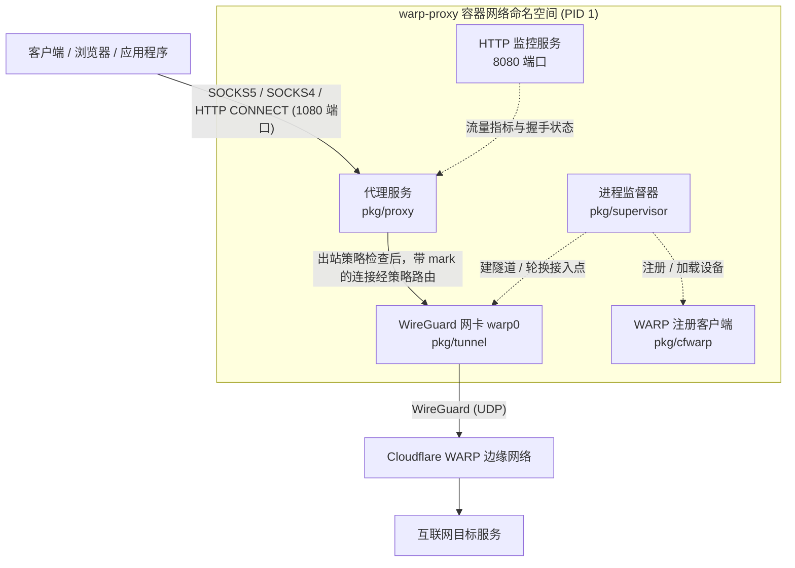

<p align="center">
  <a href="https://github.com/riba2534/warp-proxy">
    
  </a>
</p>

<h1 align="center">warp-proxy</h1>

<p align="center">
  <strong>高性能、轻量级的 Cloudflare WARP SOCKS5 代理服务</strong>
  <br />
  在容器自己的网络命名空间里用 WireGuard 直连 Cloudflare WARP，对外暴露 SOCKS5 / SOCKS4 / HTTP CONNECT 代理。
</p>

<p align="center">
  <a href="https://hub.docker.com/r/riba2534/warp-proxy"></a>
  <a href="https://github.com/riba2534/warp-proxy/actions/workflows/docker-publish.yml"></a>
  
  
  <a href="LICENSE"></a>
</p>

<p align="center">
  <a href="#warp-proxy-是什么">介绍</a> ·
  <a href="#功能总览">功能总览</a> ·
  <a href="#系统架构">系统架构</a> ·
  <a href="#快速开始">快速开始</a> ·
  <a href="#配置说明">配置说明</a> ·
  <a href="#监控与健康检查">监控与探针</a> ·
  <a href="#开发与测试">开发与测试</a>
</p>

---

## warp-proxy 是什么

`warp-proxy` 是一个极简的 Cloudflare WARP 容器化代理服务。容器启动时自动注册一个 WARP 设备，在**容器自己的网络命名空间**里建立到 Cloudflare 边缘的 WireGuard 隧道，再由内置的 Go 代理服务在 `1080` 端口提供 SOCKS5 / SOCKS4(a) / HTTP CONNECT 代理。只有代理自己发出的连接（带专用 mark 的套接字）被路由进隧道，出口即 WARP（`warp=on`）；客户端回包、Docker DNS 等其他流量照常走容器原有的路由。

v2 起不再运行 Cloudflare 官方的 `warp-svc`。官方客户端的本地代理模式只能使用 MASQUE 协议，并且常驻内存会随运行时间持续上涨（实测每天 25–45 MB，与流量无关）。v2 改用内核 WireGuard（宿主机内核缺少 WireGuard 时自动回退到用户态 `wireguard-go`），TCP 由内核协议栈承载，进程常驻内存只有十几 MiB 且不随时间增长；镜像也从 1.25 GB 缩小到约 20 MB。

## 功能总览

| 模块 | 主要能力 |
| --- | --- |
| **代理入口** | 默认监听 `0.0.0.0:1080`，同一端口自动识别 SOCKS5（RFC 1928，无认证 CONNECT）、SOCKS4/4a 与 HTTP CONNECT；`socks5h://` 域名请求经隧道内的 Cloudflare DNS 解析 |
| **WireGuard 隧道** | 自动注册 WARP 设备，内核 WireGuard 优先，缺少内核模块时回退到 `/dev/net/tun` 上的 `wireguard-go`；策略路由只把代理带 mark 的连接送进隧道，隧道缺少某个地址族时该族直接不可达，不会绕过隧道 |
| **出站安全策略** | 默认拒绝回环、私有网段（RFC 1918 / ULA）、链路本地、CGNAT、组播等目标，防止代理被用来访问容器所在的内部网络（`ALLOW_PRIVATE_DESTINATIONS=true` 可放开） |
| **接入点容灾** | 握手超时或探测失败时原地轮换 Cloudflare 接入点（多 IP、2408/500/1701/4500 等端口）并立即重新握手，进程不重启；轮换后仍持续不可用才退出，由 Docker 重启 |
| **WARP+ 密钥支持** | 通过环境变量 `WARP_LICENSE_KEY` 绑定许可密钥，切换为 WARP+ 出口 |
| **多架构原生镜像** | 静态 Go 二进制 + distroless 基础镜像，原生支持 `linux/amd64` 与 `linux/arm64` |
| **双模式健康监控** | 独立 HTTP 端口（默认 `8080`）提供 `/healthz` 探活与 `/status` 运行指标（隧道握手、流量、trace），并自带命令行健康检查探针 |
| **容器生命周期治理** | 单一 Go 二进制作为 PID 1，处理 `SIGTERM`/`SIGINT`，按序关闭代理、拆除隧道与路由 |

## 系统架构



## 快速开始

### 1. 使用 Docker Compose（推荐）

创建 `docker-compose.yml`：

```yaml
services:
  warp-proxy:
    image: riba2534/warp-proxy:v2.0.0
    container_name: warp-proxy
    restart: unless-stopped
    cap_add:
      - NET_ADMIN
    # 仅在宿主机内核没有 WireGuard 时用到（自动回退到用户态 wireguard-go）
    devices:
      - /dev/net/tun
    sysctls:
      # 开启容器内 IPv6，使 WARP 的 IPv6 出口可用
      - net.ipv6.conf.all.disable_ipv6=0
    mem_limit: 128m
    ports:
      # SOCKS5 / SOCKS4 / HTTP CONNECT 代理端口
      - "127.0.0.1:1080:1080"
      # HTTP 监控与健康检查端口（可选）
      - "127.0.0.1:8080:8080"
    environment:
      - WARP_PROXY_PORT=1080
      # 如有 WARP+ 许可证可填入，普通免费版留空即可
      - WARP_LICENSE_KEY=
      - HEALTH_PORT=8080
      - LOG_LEVEL=info
    volumes:
      # 持久化注册数据，防止容器重建后重复注册新设备
      - ./warp-data:/var/lib/cloudflare-warp
    healthcheck:
      test: ["CMD", "/usr/local/bin/warp-proxy", "-healthcheck"]
      interval: 30s
      timeout: 6s
      start_period: 60s
      retries: 3
```

启动服务：

```bash
docker compose up -d
```

### 2. 使用 Docker CLI 运行

```bash
docker run -d \
  --name warp-proxy \
  --restart unless-stopped \
  --cap-add=NET_ADMIN \
  --device /dev/net/tun \
  --sysctl net.ipv6.conf.all.disable_ipv6=0 \
  -p 127.0.0.1:1080:1080 \
  -p 127.0.0.1:8080:8080 \
  -v ./warp-data:/var/lib/cloudflare-warp \
  riba2534/warp-proxy:v2.0.0
```

### 3. 连接与使用示例

```bash
# SOCKS5，由代理在隧道内解析域名
curl -x socks5h://127.0.0.1:1080 https://cloudflare.com/cdn-cgi/trace

# HTTP CONNECT
curl -x http://127.0.0.1:1080 https://cloudflare.com/cdn-cgi/trace

# 或在当前终端设置全局代理环境变量
export ALL_PROXY=socks5h://127.0.0.1:1080
```

## 配置说明

支持通过环境变量调整各项运行时参数：

| 环境变量 | 默认值 | 说明 |
| :--- | :--- | :--- |
| `WARP_PROXY_HOST` | `0.0.0.0` | 代理服务的监听地址 |
| `WARP_PROXY_PORT` | `1080` | 代理服务的端口 |
| `PORT` | `1080` | 端口兼容配置（若未显式指定 `WARP_PROXY_PORT` 时生效） |
| `WARP_LICENSE_KEY` | *(空)* | 可选，Cloudflare WARP+ 账户许可密钥 |
| `WARP_DATA_DIR` | `/var/lib/cloudflare-warp` | 注册文件 `wireguard-account.json`（含设备私钥，权限 0600）所在目录，需持久化 |
| `WG_MODE` | `auto` | `auto`：内核 WireGuard 优先，缺少内核模块时回退用户态；`kernel`；`userspace`（需要 `/dev/net/tun`） |
| `WG_INTERFACE` | `warp0` | 容器内 WireGuard 网卡名 |
| `WG_MTU` | `1280` | 隧道 MTU（1280–1500） |
| `WG_ENDPOINT` | *(空)* | 逗号分隔的 `host:port`，优先于 Cloudflare 下发的接入点尝试 |
| `DNS_SERVERS` | `1.1.1.1,1.0.0.1,2606:4700:4700::1111,2606:4700:4700::1001` | 代理解析域名使用的 DNS（经隧道访问） |
| `ALLOW_PRIVATE_DESTINATIONS` | `false` | 设为 `true` 时允许代理访问回环、私有网段等内部地址 |
| `DIAL_TIMEOUT` | `10s` | 代理连接目标的总超时 |
| `MAX_CONNECTIONS` | `1024` | 同时接入的客户端连接上限 |
| `HEALTH_HOST` | `0.0.0.0` | HTTP 健康检查与监控服务的监听地址 |
| `HEALTH_PORT` | `8080` | HTTP 健康检查与监控服务的端口（设为 `0` 时禁用） |
| `DISABLE_HEALTH_SERVER` | `false` | 设置为 `true` 时彻底停用 HTTP 监控服务 |
| `CONNECT_TIMEOUT` | `90s` | 启动预算：注册/加载设备、建隧道并等到首次 trace 成功；接入点 6 秒内没有握手就换下一个 |
| `HEALTHCHECK_TIMEOUT` | `4s` | 每次连通性探测的总超时，在多个探测目标间分配 |
| `RECOVERY_GRACE` | `60s` | 启动后多久开始后台监控 |
| `RECOVERY_INTERVAL` | `30s` | 后台探测间隔 |
| `RECOVERY_FAILURES` | `3` | 连续失败多少次后退出（由 Docker 重启），退出前至少轮换过一次接入点；`0` 只关闭退出，仍然探测并轮换 |
| `LOG_LEVEL` | `info` | 日志输出级别 (`debug`, `info`, `warn`, `error`) |

容器需要 `NET_ADMIN` 能力，用来在**容器自己的**网络命名空间里创建 WireGuard 网卡（默认 `warp0`）和策略路由（路由表 `22337`、mark `0x57415250`，与 wg-quick 的默认值不冲突），不会改动宿主机网络。`disable_ipv6=0` 让 WARP 的 IPv6 出口可用，不开启时只走 IPv4。只清理自己创建并打过标记的网卡和规则；同名的其他网卡存在时直接报错退出。

## 监控与健康检查

### 1. HTTP `/healthz` 端点
适合接入 Kubernetes 存活/就绪探针或外部健康检查平台：
```bash
curl -i http://127.0.0.1:8080/healthz
```
- 正常响应：`HTTP 200 OK`，正文为 `OK`。
- 异常响应：`HTTP 503 Service Unavailable`，附带具体的错误原因。

### 2. HTTP `/status` 端点
获取服务运行健康状态、隧道握手与 Cloudflare trace 诊断以及实时流量指标：
```bash
curl -s http://127.0.0.1:8080/status | jq .
```
**响应示例**：
```json
{
  "status": "healthy",
  "timestamp": "2026-10-27T16:21:16Z",
  "warp_status": "Connected (kernel WireGuard via 162.159.192.1:2408, last handshake 41s ago)",
  "tunnel": {
    "mode": "kernel",
    "interface": "warp0",
    "endpoint": "162.159.192.1:2408",
    "last_handshake": "2026-10-27T16:20:35Z",
    "rx_bytes": 1830400,
    "tx_bytes": 402112,
    "ipv6": true
  },
  "trace_result": {
    "healthy": true,
    "trace_warp": "on",
    "external_ip": "104.28.238.115",
    "colo": "KIX",
    "trace_details": {
      "colo": "KIX",
      "h": "1.1.1.1",
      "ip": "104.28.238.115",
      "loc": "JP",
      "warp": "on"
    },
    "check_duration_ms": 207
  },
  "forwarder_stats": {
    "uptime_seconds": 360,
    "active_connections": 2,
    "total_connections": 184,
    "bytes_received": 1048576,
    "bytes_sent": 4194304,
    "rejected_connections": 0
  }
}
```

### 3. 原生命令行探针

Docker 镜像已配置原生 `HEALTHCHECK` 探针，执行时不依赖系统外部工具：

```bash
docker exec warp-proxy /usr/local/bin/warp-proxy -healthcheck
# 输出示例: [HEALTHCHECK OK] warp=on, ip=104.28.238.115, colo=KIX (duration: 207ms)
```

## 从 v1 升级

- 保留原来挂载的 `/var/lib/cloudflare-warp` 卷即可。v2 首次启动会注册一个新的 WireGuard 设备，写入 `wireguard-account.json`；v1 官方客户端留下的文件不会被修改，回退到 `v1.1.0` 时仍可使用。
- 新设备意味着新的 WARP 出口 IP（仍是 `warp=on` 的 Cloudflare 地址）。
- `WARP_SVC_HOST` / `WARP_SVC_PORT` 已不再使用，可以删除。
- 镜像基于 distroless，不再包含 shell、curl 等工具：健康检查必须写成 exec 形式（`["CMD", "/usr/local/bin/warp-proxy", "-healthcheck"]`），`CMD-SHELL` 或依赖 curl 的写法会一直报 unhealthy；`docker exec ... sh` 也不可用。
- 建议在 compose 中加入上面的 `sysctls`；`/dev/net/tun` 只在内核没有 WireGuard 时需要。
- 需要回退时，把镜像换回 `riba2534/warp-proxy:v1.1.0`（按 digest 固定更稳妥）。

## 故障排查

- **日志出现 `falling back to userspace`**：宿主机内核没有 WireGuard 模块，已改用 `wireguard-go`。需要映射 `/dev/net/tun`；想用内核模式可在宿主机执行 `modprobe wireguard`。
- **启动后一直没有握手**：所在网络可能封锁了 WireGuard 的 UDP。服务会自动轮换接入点与端口，也可以用 `WG_ENDPOINT` 指定可用的接入点，例如 `162.159.192.1:2408`。
- **`/status` 中 `ipv6` 为 `false`**：容器里 IPv6 被禁用，加上 `net.ipv6.conf.all.disable_ipv6=0` 后重建容器。
- **使用 `network_mode: host`**：可以运行，网卡、路由表与规则会建在宿主机的网络命名空间里，只作用于代理自己的连接，退出时全部撤销。宿主机已有同名网卡时用 `WG_INTERFACE` 换一个名字；宿主机自己已经在用 WARP（例如 wg-quick，地址同为 `172.16.0.2`）时会拒绝启动，此时请改用 bridge 网络。
- **内核不支持 IPv6 策略路由**（部分 NAS 内核）：日志会提示设置 `net.ipv6.conf.all.disable_ipv6=1`，禁用容器内 IPv6 后只走 IPv4。
- **注销设备**：停止容器后执行 `docker run --rm -v ./warp-data:/var/lib/cloudflare-warp riba2534/warp-proxy:v2.0.0 -unregister`。

## 开发与测试

```bash
# 单元测试（包含数据竞态检测）
go test -race ./...

# 隧道集成测试：只在全新的网络命名空间里运行，不触碰宿主机网络
go test -c -tags integration -o /tmp/tunnel.test ./pkg/tunnel
sudo unshare --net /tmp/tunnel.test -test.v

# 编译本地二进制
go build -o bin/warp-proxy ./cmd/warp-proxy

# 构建本地 Docker 镜像
docker build -t warp-proxy:latest .
```

WARP 注册协议参考了 [ViRb3/wgcf](https://github.com/ViRb3/wgcf)（MIT）。本项目与 Cloudflare 无关，使用即表示同意 [Cloudflare 服务条款](https://www.cloudflare.com/application/terms/)。

## 开源许可证

本项目采用 [MIT 许可证](LICENSE) 开源。
